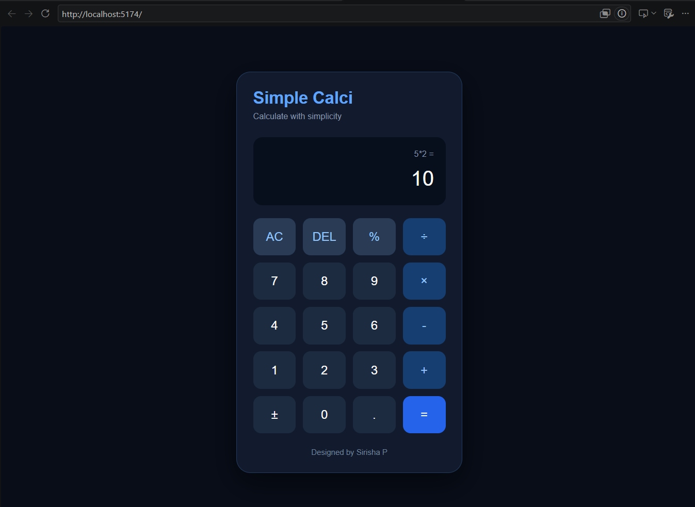
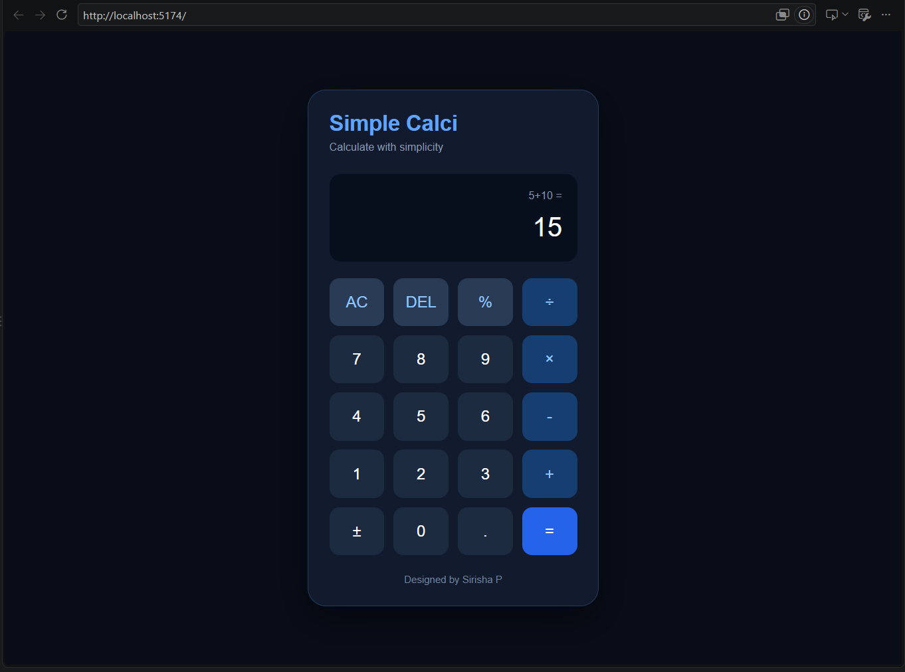

# Ex04 Simple Calculator - React Project
## Date:24-11-2026
## Name : SIRISHA P
## Reg No : 212224040321

## AIM
To  develop a Simple Calculator using React.js with clean and responsive design, ensuring a smooth user experience across different screen sizes.

## ALGORITHM
### STEP 1
Create a React App.

### STEP 2
Open a terminal and run:
  <ul><li>npx create-react-app simple-calculator</li>
  <li>cd simple-calculator</li>
  <li>npm start</li></ul>

### STEP 3
Inside the src/ folder, create a new file Calculator.js and define the basic structure.

### STEP 4
Plan the UI: Display screen, number buttons (0-9), operators (+, -, *, /), clear (C), and equal (=).

### STEP 5
Create a new file Calculator.css in src/ and add the styling.

### STEP 6
Open src/App.js and modify it.

### STEP 7
Start the development server.
  npm start

### STEP 8
Open http://localhost:3000/ in the browser.

### STEP 9
Test the calculator by entering numbers and operations.

### STEP 10
Fix styling issues and refine content placement.

### STEP 11
Deploy the website.

### STEP 12
Upload to GitHub Pages for free hosting.

## PROGRAM

## App.css

```css

.calculator {
  width: 350px;
  padding: 25px;
  background: #111b2d;
  border: 1px solid #233b5e;
  border-radius: 22px;
  box-shadow: 0 15px 45px #0008;
}

.header {
  margin-bottom: 25px;
}

.header h1 {
  color: #60a5fa;
  font-size: 26px;
}

.header p {
  color: #8998ad;
  font-size: 13px;
  margin-top: 6px;
}

.display {
  background: #080f1c;
  border-radius: 14px;
  padding: 18px;
  margin-bottom: 20px;
  text-align: right;
  min-height: 105px;
  overflow: hidden;
}

.expression {
  color: #8192aa;
  font-size: 13px;
  min-height: 20px;
}

.result {
  color: white;
  font-size: 32px;
  margin-top: 8px;
  overflow-x: auto;
}

.buttons {
  display: grid;
  grid-template-columns: repeat(4, 1fr);
  gap: 11px;
}

.buttons button {
  height: 58px;
  border: none;
  border-radius: 12px;
  background: #1d2b41;
  color: white;
  font-size: 19px;
  cursor: pointer;
  transition: 0.2s;
}

.buttons button:hover {
  background: #304765;
  transform: translateY(-2px);
}

.buttons .utility {
  background: #293b55;
  color: #93c5fd;
}

.buttons .operator {
  background: #173e70;
  color: #93c5fd;
}

.buttons .equal {
  background: #2563eb;
  color: white;
}

.buttons .equal:hover {
  background: #3b82f6;
}

footer {
  text-align: center;
  color: #71839c;
  font-size: 12px;
  margin-top: 22px;
}

@media (max-width: 400px) {
  .calculator {
    width: 100%;
    padding: 18px;
  }
}

```
## App.jsx

```jsx

import { useState } from "react";
import "./App.css";

function App() {
  const [display, setDisplay] = useState("0");
  const [expression, setExpression] = useState("");

  const handleClick = (value) => {
    if (value === "AC") {
      setDisplay("0");
      setExpression("");
    } else if (value === "DEL") {
      setDisplay(display.length > 1 ? display.slice(0, -1) : "0");
    } else if (value === "=") {
      try {
        if (!/^[0-9+\-*/.()\s]+$/.test(display)) {
          throw new Error("Invalid expression");
        }

        const answer = Function('"use strict"; return (' + display + ')')();

        if (!Number.isFinite(answer)) throw new Error();

        setExpression(display + " =");
        setDisplay(String(Number(answer.toPrecision(12))));
      } catch {
        setDisplay("Error");
        setExpression("Invalid calculation");
      }
    } else if (value === "±") {
      if (display !== "0" && display !== "Error") {
        setDisplay(display.startsWith("-") ? display.slice(1) : "-" + display);
      }
    } else if (value === "%") {
      const answer = Number(display) / 100;
      if (Number.isFinite(answer)) setDisplay(String(answer));
    } else {
      if (display === "Error") {
        setDisplay(value);
      } else {
        setDisplay(display === "0" ? value : display + value);
      }
      setExpression("");
    }
  };

  const buttons = [
    "AC", "DEL", "%", "/",
    "7", "8", "9", "*",
    "4", "5", "6", "-",
    "1", "2", "3", "+",
    "±", "0", ".", "="
  ];

  return (
    <div className="calculator">
      <header className="header">
        <h1>Simple Calci</h1>
        <p>Calculate with simplicity</p>
      </header>

      <div className="display">
        <div className="expression">
          {expression || "Ready to calculate"}
        </div>
        <div className="result">{display}</div>
      </div>

      <div className="buttons">
        {buttons.map((button) => (
          <button
            key={button}
            onClick={() => handleClick(button)}
            className={
              button === "=" ? "equal" :
              ["/", "*", "-", "+"].includes(button) ? "operator" :
              ["AC", "DEL", "%"].includes(button) ? "utility" : ""
            }
          >
            {button === "*" ? "×" : button === "/" ? "÷" : button}
          </button>
        ))}
      </div>

      <footer>Designed by Sirisha P</footer>
    </div>
  );
}

export default App;

```

## index.css

```css

* {
  margin: 0;
  padding: 0;
  box-sizing: border-box;
}

body {
  min-height: 100vh;
  display: flex;
  justify-content: center;
  align-items: center;
  background: #080d18;
  font-family: Arial, sans-serif;
  color: white;
  padding: 20px;
}

button {
  font-family: inherit;
}

```

## main.jsx

```jsx

import React from "react";
import ReactDOM from "react-dom/client";
import App from "./App";
import "./index.css";

ReactDOM.createRoot(document.getElementById("root")).render(
  <React.StrictMode>
    <App />
  </React.StrictMode>
);

```

## OUTPUT





## RESULT
The program for developing a simple calculator in React.js is executed successfully.